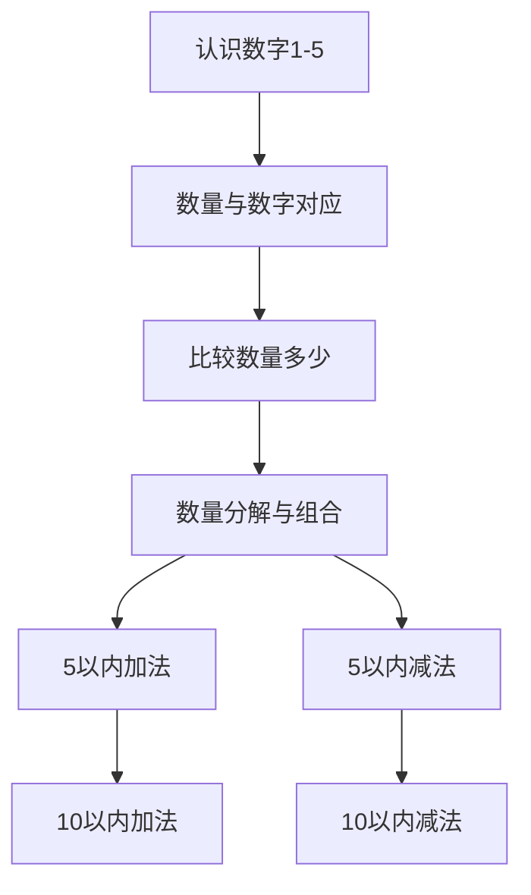
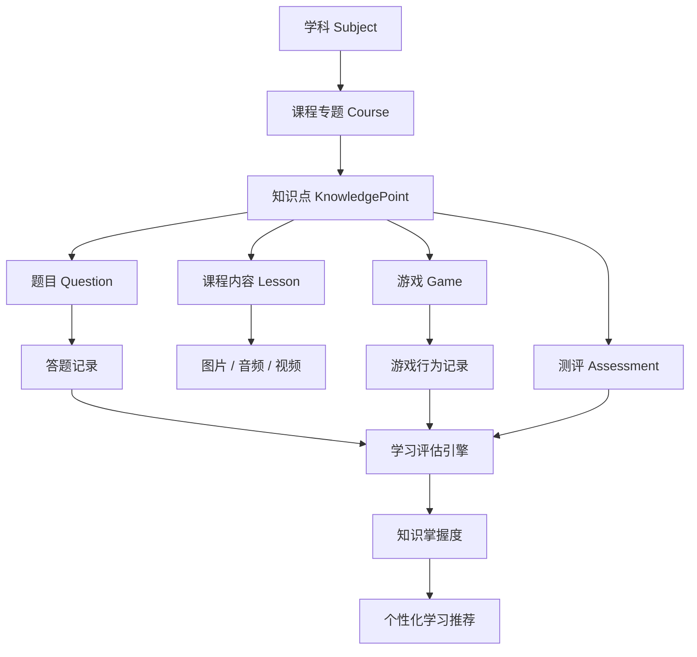

# **Kids Edu App：3～6岁中英启蒙课程与知识点三级结构规划**

我建议这次把课程体系作为 Kids Edu App 下一阶段的核心基础设施来设计，而不是简单整理一份课程目录。

核心目标是建立一套可以同时支撑 **课程管理、知识点管理、互动游戏、AI 出题、学习评估、个性化推荐和家长成长报告** 的统一知识体系。

我的总体设计建议是：

- 一级：学科领域（Subject）
    
- 二级：课程专题（Course）
    
- 三级：知识点（Knowledge Point）
    

三级结构之下，再挂载具体教学资源和学习活动，例如课程讲解、绘本、题目、游戏、音频、动画和测评。
![[Pasted image 20261125130053.png]]
## **课程知识体系总览**

## **一级：学科领域 Subject**

英语启蒙 · 中文启蒙 · 数学启蒙 · 认知科学 · 生活能力 · 艺术创造

## **二级：课程专题 Course**

例如：英语自然拼读、数字认知、汉字启蒙、动物认知

## **三级：知识点 Knowledge Point**

例如：认识字母 A、认识数字 1、区分圆形和正方形

**课程内容**

讲解、绘本、动画

**学习活动**

练习、游戏、任务

**学习评估**

测评、错题、复习

这里有一个重要设计原则：**课程是教学组织单位，知识点是学习和评估单位，游戏是教学活动载体。**

三者不要混为一谈。例如「认识数字 1～10」是一门课程专题，「认识数字 1」是知识点，「数字找朋友」是可以服务多个知识点的游戏。

# **一、一级学科：建议建设六大领域**

针对 3～6 岁儿童，我建议首期规划六大领域。

|编码|学科领域|核心目标|优先级|
|---|---|---|---|
|EN|英语启蒙|听说、词汇、自然拼读|P0|
|ZH|中文启蒙|听说、识字、拼音、阅读|P0|
|MA|数学启蒙|数感、运算、逻辑思维|P0|
|CO|认知科学|观察、分类、记忆、空间认知|P0|
|LI|生活能力|生活常识、安全、习惯|P1|
|AR|艺术创造|音乐、绘画、手工、创造力|P2|

为什么把认知科学独立出来？

因为儿童的观察、分类、记忆、空间关系和逻辑思维并不完全属于数学。把这些能力独立出来，可以设计大量跨学科的互动游戏，也方便后续进行综合能力训练。

另外，英语和中文都应该覆盖听、说、读等能力，但不应该机械地把成人语言学习体系缩小。3～4 岁尤其应优先关注听说、韵律、图像和情境理解。

## **1. 英语启蒙 EN**

![[Pasted image 20261125130148.png|345]]![[Pasted image 20261125130205.png|247]]
![[Pasted image 20261125130240.png|244]]![[Pasted image 20261125130251.png|205]]![[Pasted image 20261125130311.png|204]]
![[Pasted image 20261125130332.png|234]]![[Pasted image 20261125130344.png|206]]![[Pasted image 20261125130413.png|196]]

| 二级课程专题    | 三级知识点示例                  |
| --------- | ------------------------ |
| EN01 字母认知 | 认识 A-Z、字母大小写配对、字母排序      |
| EN02 自然拼读 | 字母发音、首音识别、辅音发音、简单 CVC 拼读 |
| EN03 基础词汇 | 动物、水果、颜色、数字、身体、家庭、食物     |
| EN04 日常表达 | 问候、自我介绍、表达需求、感谢与道别       |
| EN05 听力理解 | 听词辨图、听指令做动作、听短句选图        |
| EN06 口语表达 | 单词跟读、短语表达、情景对话           |
| EN07 英语绘本 | 词汇理解、简单句理解、故事排序          |
| EN08 英语韵律 | 儿歌、押韵、节奏、韵律模仿            |

这里特别建议将自然拼读与字母认知分开。

例如，知道字母 A 的形状和名称，不等于掌握字母 A 在单词中的发音。

## **2. 中文启蒙 ZH**

![[Pasted image 20261125130451.png|207]]![[Pasted image 20261125143903.png|246]]![[Pasted image 20261125143918.png|240]]
![[Pasted image 20261125143948.png|220]]![[Pasted image 20261125144000.png|233]]![[Pasted image 20261125144015.png|243]]
![[Pasted image 20261125144047.png|223]]![[Pasted image 20261125144113.png|235]]![[Pasted image 20261125144126.png|242]]
![[Pasted image 20261125144150.png|226]]![[Pasted image 20261125144159.png|215]]

|二级课程专题|三级知识点示例|
|---|---|
|ZH01 语言听说|听指令、词语理解、完整表达、情景交流|
|ZH02 拼音启蒙|声母认知、韵母认知、声调辨识、简单拼读|
|ZH03 汉字启蒙|象形认知、常见汉字、偏旁初识、字形辨认|
|ZH04 词语积累|动物词汇、植物词汇、家庭词汇、生活词汇|
|ZH05 句子表达|词语组合、简单句、描述图片、表达需求|
|ZH06 儿歌童谣|儿歌欣赏、节奏模仿、韵律感知|
|ZH07 古诗启蒙|古诗欣赏、诗句理解、诗词诵读|
|ZH08 绘本阅读|图片理解、故事情节、人物认知、情节排序|

拼音方面建议作为后续逐步引入的内容，不要把 3～4 岁儿童的中文启蒙变成拼音识字训练。

## **3. 数学启蒙 MA**

![[Pasted image 20261125144219.png|218]]![[Pasted image 20261125144233.png|219]]![[Pasted image 20261125144251.png|247]]
![[Pasted image 20261125144312.png|219]]![[Pasted image 20261125144322.png|222]]![[Pasted image 20261125144336.png|240]]
![[Pasted image 20261125144403.png|217]]![[Pasted image 20261125144414.png|226]]![[Pasted image 20261125144427.png|235]]

|二级课程专题|三级知识点示例|
|---|---|
|MA01 数字认知|认识 1～10、认识 11～20、数字排序|
|MA02 数量与数感|一一对应、数物匹配、多少比较、数量估计|
|MA03 数字运算|5 以内加减法、10 以内加减法、20 以内初步运算|
|MA04 图形认知|圆形、正方形、三角形、长方形、立体图形|
|MA05 规律排序|颜色规律、形状规律、数字规律、序列补全|
|MA06 分类比较|大小、长短、高矮、轻重、分类归纳|
|MA07 空间认知|上下、左右、前后、里外、位置关系|
|MA08 时间认知|早晚、昨天今天明天、季节、日常时间顺序|
|MA09 生活数学|认识钱币、数量分配、简单测量|

注意：数学知识点要按照儿童发展水平设计。例如 3～4 岁主要是数量感知和简单比较，不能简单将 20 以内运算作为所有孩子的必修目标。

## **4. 认知科学 CO**

![[Pasted image 20261125144503.png|200]]![[Pasted image 20261125144523.png|261]]![[Pasted image 20261125144539.png|222]]
![[Pasted image 20261125144624.png|209]]![[Pasted image 20261125144635.png|259]]![[Pasted image 20261125144657.png|227]]

|二级课程专题|三级知识点示例|
|---|---|
|CO01 观察识别|物体特征、细节观察、相同与不同|
|CO02 分类归纳|按颜色分类、按形状分类、按用途分类|
|CO03 逻辑推理|因果关系、规律判断、简单推理|
|CO04 记忆训练|图片记忆、声音记忆、顺序记忆|
|CO05 空间思维|拼图、空间组合、方向判断|
|CO06 专注训练|目标查找、差异辨别、持续注意|
|CO07 科学探索|动植物、天气、自然现象、简单物理现象|
|CO08 时间与顺序|事件排序、生活流程、故事排序|

这里建议把认知训练设计为游戏驱动型课程，尤其适合利用现有的记忆翻牌、找不同、图形配对等游戏。

## **5. 生活能力 LI**

|二级课程专题|三级知识点示例|
|---|---|
|LI01 生活习惯|刷牙、洗手、整理玩具、独立进食|
|LI02 身体健康|身体部位、健康饮食、运动习惯|
|LI03 安全教育|交通安全、防走失、防烫伤、危险物品识别|
|LI04 社交礼仪|分享、轮流、礼貌表达、合作|
|LI05 情绪认知|识别开心、难过、生气、表达感受|
|LI06 自我认知|认识自己、家庭成员、个人物品|

## **6. 艺术创造 AR**

|二级课程专题|三级知识点示例|
|---|---|
|AR01 色彩认知|基础颜色、颜色混合、冷暖色初识|
|AR02 绘画启蒙|线条、形状组合、简单图案|
|AR03 音乐启蒙|节奏、音高、声音辨识、音乐欣赏|
|AR04 手工创造|拼贴、折纸、积木搭建|
|AR05 创意表达|自由绘画、故事创编、声音创作|

以上六大学科建议先建立完整目录，但首期不要追求全部内容填充。建议先做英语、中文和数学的基础专题，再通过认知科学扩充互动游戏。

# **二、年龄分层：不要把年龄作为第四级目录**

这是整个课程体系非常重要的设计。

建议每一个知识点都可以配置三个年龄阶段的学习目标：
![[Pasted image 20261125144720.png]]
## **3～6岁年龄发展分层**

# **3～4岁**

**感知探索**

认识、观察、模仿、体验

# **4～5岁**

**理解运用**

理解、比较、分类、表达

# **5～6岁**

**综合应用**

应用、推理、创造、迁移

**以「认识数字 1～10」为例**

|年龄|学习目标|
|---|---|
|3～4岁|能辨认部分数字，进行简单数物对应|
|4～5岁|认识 1～10，能够点数并对应数量|
|5～6岁|理解数字顺序、数量关系及简单分解组合|

这里的年龄目标是参考性发展目标，不应成为强制升级门槛。孩子可以提前掌握，也可以反复练习。

这一设计可以参考教育部《3～6岁儿童学习与发展指南》的年龄分段方式和发展目标。该指南强调健康、语言、社会、科学、艺术五大领域，并反对幼儿教育小学化和机械强化训练。

教育部+2

## **三、需要增加的两个重要领域**

前面六大领域是按照产品功能拆分的，若要建立更完整的幼儿教育课程体系，我建议再做一次结构调整：

**将六大产品学科映射到五大幼儿发展领域。**

这是为了避免认知科学、数学、生活能力之间出现割裂。

|产品学科|对应发展领域|
|---|---|
|英语启蒙、中文启蒙|语言|
|数学启蒙、科学探索|科学|
|认知训练|科学（观察、探索、推理）|
|生活能力、健康习惯|健康|
|社交与情绪认知|社会|
|艺术创造|艺术|

因此，建议正式的一级学科采用下面七个模块：

1. 中文启蒙
    
2. 英语启蒙
    
3. 数学启蒙
    
4. 科学探索与认知
    
5. 健康与生活
    
6. 社交与情绪
    
7. 艺术与创造
    

这七个模块更符合产品实际使用习惯，同时能够覆盖五大幼儿发展领域。

# **四、三级结构的完整示例**

为了避免只有目录没有实际落地价值，下面给出三个完整的课程树。

## **示例 A：英语启蒙**

```
EN 英语启蒙
│
├── EN01 字母认知
│   ├── EN01-001 认识大写字母 A-Z
│   ├── EN01-002 认识小写字母 a-z
│   ├── EN01-003 大小写字母配对
│   ├── EN01-004 字母顺序排列
│   └── EN01-005 字母形状辨识
│
├── EN02 自然拼读
│   ├── EN02-001 字母与发音对应
│   ├── EN02-002 元音与辅音初识
│   ├── EN02-003 单词首音识别
│   ├── EN02-004 单词尾音识别
│   ├── EN02-005 简单 CVC 单词拼读
│   └── EN02-006 简单押韵词识别
│
├── EN03 基础词汇
│   ├── EN03-001 动物词汇
│   ├── EN03-002 水果词汇
│   ├── EN03-003 颜色词汇
│   ├── EN03-004 数字词汇
│   ├── EN03-005 身体部位
│   ├── EN03-006 家庭成员
│   ├── EN03-007 食物饮品
│   ├── EN03-008 交通工具
│   └── EN03-009 日常物品
│
├── EN04 日常表达
│   ├── EN04-001 问候与道别
│   ├── EN04-002 自我介绍
│   ├── EN04-003 表达喜欢与不喜欢
│   ├── EN04-004 表达需求
│   ├── EN04-005 礼貌用语
│   └── EN04-006 简单问答
│
├── EN05 英语听力
│   ├── EN05-001 听音辨图
│   ├── EN05-002 听词辨物
│   ├── EN05-003 听懂简单指令
│   └── EN05-004 听懂简单句子
│
├── EN06 英语口语
│   ├── EN06-001 单词跟读
│   ├── EN06-002 短语模仿
│   ├── EN06-003 简单句表达
│   └── EN06-004 情景对话
│
└── EN07 英语绘本与儿歌
    ├── EN07-001 英语儿歌欣赏
    ├── EN07-002 英语童谣跟唱
    ├── EN07-003 绘本图片理解
    ├── EN07-004 故事情节排序
    └── EN07-005 简单故事复述
```

## **示例 B：数学启蒙**

```
MA 数学启蒙
│
├── MA01 数字认知
│   ├── MA01-001 认识数字 1-5
│   ├── MA01-002 认识数字 6-10
│   ├── MA01-003 认识数字 11-20
│   ├── MA01-004 数字顺序排列
│   └── MA01-005 数字与数量对应
│
├── MA02 数量与数感
│   ├── MA02-001 物体点数
│   ├── MA02-002 一一对应
│   ├── MA02-003 比较多少
│   ├── MA02-004 数量大小比较
│   ├── MA02-005 数量分组
│   └── MA02-006 数量分解与组合
│
├── MA03 加减法启蒙
│   ├── MA03-001 理解增加的概念
│   ├── MA03-002 理解减少的概念
│   ├── MA03-003 5以内加法
│   ├── MA03-004 5以内减法
│   ├── MA03-005 10以内加法
│   ├── MA03-006 10以内减法
│   └── MA03-007 生活情景加减法
│
├── MA04 图形认知
│   ├── MA04-001 认识圆形
│   ├── MA04-002 认识正方形
│   ├── MA04-003 认识三角形
│   ├── MA04-004 认识长方形
│   ├── MA04-005 平面图形分类
│   └── MA04-006 立体图形初识
│
├── MA05 规律与排序
│   ├── MA05-001 颜色规律
│   ├── MA05-002 形状规律
│   ├── MA05-003 大小规律
│   ├── MA05-004 简单序列补全
│   └── MA05-005 多条件规律
│
├── MA06 分类与比较
│   ├── MA06-001 按颜色分类
│   ├── MA06-002 按形状分类
│   ├── MA06-003 按用途分类
│   ├── MA06-004 长短比较
│   └── MA06-005 高矮比较
│
├── MA07 空间认知
│   ├── MA07-001 上下关系
│   ├── MA07-002 前后关系
│   ├── MA07-003 左右关系
│   ├── MA07-004 里外关系
│   └── MA07-005 方位与位置
│
└── MA08 时间与生活数学
    ├── MA08-001 认识早晨与晚上
    ├── MA08-002 昨天今天明天
    ├── MA08-003 认识季节
    ├── MA08-004 认识简单钱币
    └── MA08-005 简单测量
```

## **示例 C：中文启蒙**

```
ZH 中文启蒙
│
├── ZH01 语言理解与表达
│   ├── ZH01-001 听懂日常指令
│   ├── ZH01-002 认识常见事物名称
│   ├── ZH01-003 完整表达简单需求
│   ├── ZH01-004 描述图片内容
│   └── ZH01-005 简单情景交流
│
├── ZH02 汉字启蒙
│   ├── ZH02-001 认识生活中的常见汉字
│   ├── ZH02-002 象形汉字初识
│   ├── ZH02-003 汉字与图片匹配
│   ├── ZH02-004 常见汉字辨认
│   └── ZH02-005 简单词语理解
│
├── ZH03 拼音启蒙
│   ├── ZH03-001 声母初识
│   ├── ZH03-002 韵母初识
│   ├── ZH03-003 声调感知
│   ├── ZH03-004 拼音与发音对应
│   └── ZH03-005 简单拼读体验
│
├── ZH04 词语积累
│   ├── ZH04-001 动物词汇
│   ├── ZH04-002 植物词汇
│   ├── ZH04-003 家庭词汇
│   ├── ZH04-004 食物词汇
│   └── ZH04-005 生活词汇
│
├── ZH05 儿歌与古诗
│   ├── ZH05-001 经典儿歌
│   ├── ZH05-002 童谣节奏
│   ├── ZH05-003 古诗欣赏
│   ├── ZH05-004 古诗诵读
│   └── ZH05-005 诗句情景理解
│
└── ZH06 绘本阅读
    ├── ZH06-001 图片观察
    ├── ZH06-002 人物识别
    ├── ZH06-003 故事情节理解
    ├── ZH06-004 故事顺序排列
    └── ZH06-005 简单故事复述
```

以上目录是首版内容规划，不代表每个知识点都必须同时开发三个年龄版本。

# **五、知识点的数据结构设计**

这部分是后续 Code Agent 开发时最重要的内容。

建议每个三级知识点都不仅仅是一个名称，而是一个独立的、可配置、可评估、可关联游戏的学习单元。

### **1. KnowledgePoint 核心定义**

建议字段：

|字段|类型|说明|
|---|---|---|
|id|String|知识点唯一 ID|
|code|String|知识点编码|
|subjectId|String|所属学科|
|courseId|String|所属课程专题|
|name|String|知识点名称|
|description|String|知识点描述|
|objectives|JSON|学习目标|
|ageTargets|JSON|各年龄阶段目标|
|difficulty|Int|基础难度 1～5|
|prerequisites|JSON|前置知识点|
|learningMethods|JSON|推荐学习方式|
|assessmentCriteria|JSON|掌握标准|
|status|Enum|草稿、发布、下线|
|sortOrder|Int|排序|
|version|Int|内容版本|

### **2. 年龄目标配置**

例如「认识数字 1～10」：

```
{
  "ageTargets": {
    "3-4": {
      "level": "exploration",
      "objectives": [
        "认识部分常见数字",
        "能够进行简单数物匹配"
      ],
      "activities": [
        "数字卡片",
        "数物配对"
      ]
    },
    "4-5": {
      "level": "understanding",
      "objectives": [
        "认识数字1-10",
        "能够正确点数"
      ],
      "activities": [
        "数字排序",
        "数量配对"
      ]
    },
    "5-6": {
      "level": "application",
      "objectives": [
        "理解数字顺序",
        "理解简单数量关系"
      ],
      "activities": [
        "数字闯关",
        "数量分解"
      ]
    }
  }
}
```

### **3. 课程与游戏的关联模型**

我特别建议不要把游戏直接写死在课程里面，而是建立多对多关联。

例如：
![[Pasted image 20261125144814.png]]

**知识点：认识数字 1～10**

**关联课程内容**

- 数字认知视频
    
- 数字卡片
    
- 数字儿歌
    
- 数量讲解
    

**关联游戏**

- 数字找朋友
    
- 数量配对
    
- 数字排序
    
- 数字消消乐
    

**关联评估**

- 数字识别
    
- 数量对应
    
- 数字排序
    
- 简单数量比较
    

建议增加：

- `KnowledgeResource`：知识点教学资源。
    
- `KnowledgeGame`：知识点与游戏的关联。
    
- `KnowledgeQuestion`：知识点与题目的关联。
    

这样一款游戏可以服务多个知识点，一个知识点也可以拥有多种教学和练习方式。

# **六、知识点之间增加前置依赖关系**

这点非常重要。

三级课程目录只是树状结构，但真实的学习过程并不完全是树状的。

例如：


建议在 KnowledgePoint 中增加：

```
interface KnowledgeDependency {
  sourceKnowledgePointId: string;
  targetKnowledgePointId: string;
  relationType:
    | "prerequisite"
    | "related"
    | "extension";
  weight?: number;
}
```

这样未来可以支持：

- 根据前置知识判断能否学习新知识。
    
- 发现孩子的基础薄弱环节。
    
- 自动生成学习路径。
    
- 根据错误情况回退到前置知识点。
    
- 推荐关联知识点进行巩固。
    

不要把前置知识直接限制为单一 `parentId`，因为知识点之间可能存在跨专题依赖。

# **七、建议将课程内容与知识点分开版本管理**

建议形成以下逻辑：



其中：

- Subject、Course、KnowledgePoint 负责课程知识体系。
    
- Lesson 负责教学过程。
    
- Question 负责练习题。
    
- Game 负责互动玩法。
    
- Assessment 负责阶段性测评。
    
- LearningEvent 负责学习行为记录。
    

这个划分能有效避免未来把所有教学内容都塞进 `Level.config` 或 `Game.config`。

# **八、建议最终采用的课程目录**

我建议把一级学科正式定义为下面七类：

|一级学科|二级课程数量（建议）|首期优先级|
|---|---|---|
|中文启蒙|6|P0|
|英语启蒙|7|P0|
|数学启蒙|8|P0|
|科学探索与认知|8|P1|
|健康与生活|6|P1|
|社交与情绪|5|P1|
|艺术与创造|5|P2|
|**合计**|**45**||

这些是规划中的专题数量，不是必须立即上线的数量。每个专题可以逐步建设 5～15 个三级知识点。

## **九、推荐开发顺序**

![[Pasted image 20261125145205.png]]
不要一次性把全部知识点录入数据库。建议分批建设：
第一批

**英语 + 数学 + 中文基础知识点**

- 英语：字母、基础词汇、日常表达
    
- 数学：数字、数量、图形、简单运算
    
- 中文：语言表达、汉字、儿歌、绘本
    

先让现有课程与游戏全部关联到统一知识点。

第二批

**科学认知 + 生活能力**

- 动植物、自然、天气
    
- 观察、分类、记忆、逻辑
    
- 生活习惯、安全教育
    

重点扩展现有游戏的可复用性。

**第三批**

**社交情绪 + 艺术创造**

- 情绪认知
    
- 社交礼仪
    
- 音乐节奏
    
- 绘画与创意表达
    

完善综合素养类课程。

# **十、最终建议：把这套结构沉淀为可执行的技术规范**

为了让后续 Codex、Claude Code 等 Code Agent 能持续扩展课程，我建议在仓库中建立独立的课程体系规范。

```
docs/
└── curriculum/
    ├── README.md                    # 课程体系设计总览
    ├── curriculum-taxonomy.md       # 七大学科三级目录
    ├── age-development.md           # 3-4/4-5/5-6年龄目标
    ├── knowledge-point-spec.md      # 知识点规范
    ├── learning-objectives.md       # 学习目标规范
    ├── knowledge-dependencies.md    # 知识点依赖关系
    ├── content-schema.md            # 内容数据规范
    └── game-mapping.md              # 游戏与知识点映射

content/
├── subjects/
│   ├── chinese/
│   ├── english/
│   ├── math/
│   ├── science/
│   ├── health/
│   ├── social/
│   └── art/
├── schemas/
│   ├── subject.schema.json
│   ├── course.schema.json
│   ├── knowledge-point.schema.json
│   ├── lesson.schema.json
│   └── question.schema.json
└── fixtures/
```

**还有一个我认为很重要的设计：** 三级目录只负责知识分类，不要把所有教学活动都强行塞进三级目录。未来可以在知识点下面配置多个 Lesson、Question、Game 和 Assessment。这样课程体系稳定，教学内容可以持续扩充。

这套规划还需要经过儿童教育专业人员的内容审核，尤其是年龄目标和评估标准。

我的建议是：先以这套七大学科、约45个课程专题为正式 V1 课程目录，优先完成中文、英语、数学三个学科的知识点定义，并把现有课程和游戏迁移到知识点体系中。

参考依据：

- [教育部《3～6岁儿童学习与发展指南》](https://www.moe.gov.cn/jyb_xwfb/xw_zt/moe_357/jyzt_2015nztzl/xueqianjiaoyu/yaowen/202104/W020210820338905908083.pdf?utm_source=chatgpt.com)
    
- [教育部学前教育专家关于五大领域及教学方式的解读](https://www.moe.gov.cn/jyb_xwfb/s271/201210/t20121015_143257.html?authkey=boxdr3&utm_source=chatgpt.com)