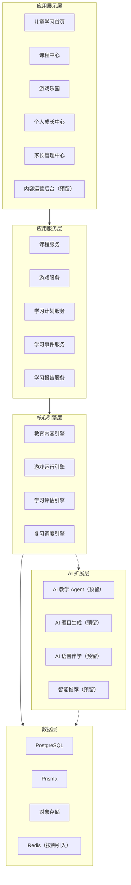
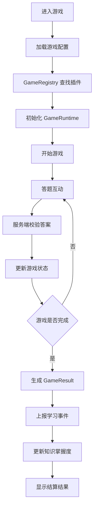
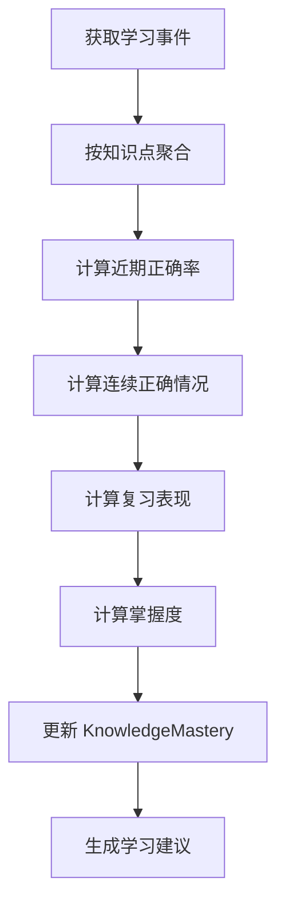

# Kids Edu App V1.1 技术改造任务书

**项目名称：** Kids Edu App 教育内容引擎与个性化学习系统升级

**版本：** V1.1

**项目类型：** 现有项目架构优化与核心能力建设

**目标平台：** Web / PWA，兼容后续 Capacitor 移动端封装

**技术基线：** Next.js 16、React 19、TypeScript、Prisma 6、PostgreSQL、Tailwind CSS 4、Zod 4

---

# 一、项目背景

Kids Edu App 当前已经具备儿童启蒙教育 MVP 的基础能力，覆盖今日学习、课程、游戏、个人中心、家长中心等主要功能。

现阶段已经形成了以下基础：

1. 按 3～6 岁年龄段组织中英文启蒙课程。
    
2. 具备课程关卡、游戏配置和 JSON Schema 校验机制。
    
3. 已有多个互动小游戏。
    
4. 已有学习进度、每日任务、游戏次数等基础功能。
    
5. 已有家长中心和多儿童档案设计。
    
6. 已采用 Next.js + Prisma + PostgreSQL 技术体系。
    

但从长期产品演进来看，目前系统仍以固定课程、固定关卡和独立游戏为主，缺乏统一的知识点体系、学习行为分析、知识掌握度评估以及个性化学习推荐能力。

因此，本次升级的核心目标不是推倒重做，而是在保留现有产品和技术基础的前提下，建设统一的教育内容引擎。

# 二、总体建设目标

## 2.1 核心目标

建设一个以知识点为核心、课程与游戏统一驱动、学习行为可追踪、学习效果可评估的儿童智能教育系统。

核心设计理念：

**一个教育内容引擎 + 一个游戏运行引擎 + 一个学习评估引擎 + 一个 AI 教学扩展层。**

四个核心引擎的职责：

|引擎|核心职责|
|---|---|
|教育内容引擎|统一管理学科、课程、知识点、题目、关卡和教学资源|
|游戏运行引擎|统一管理小游戏生命周期、交互、评分和学习数据上报|
|学习评估引擎|记录学习行为、评估知识掌握度、生成复习计划|
|AI 教学扩展层|提供 AI 讲题、个性化出题、语音伴学和智能推荐|

## 2.2 本期建设范围

本期重点建设 V1.1 基础能力：

- 统一课程与知识点数据模型。
    
- 统一题目和游戏内容模型。
    
- 建立教育内容 Schema 和运行时校验机制。
    
- 建立游戏插件接口。
    
- 建立学习行为事件系统。
    
- 建立知识点掌握度评估机制。
    
- 建立个性化复习计划。
    
- 完善数据库持久化和数据权限。
    
- 保持现有页面和业务流程兼容。
    

AI Agent、复杂知识图谱、AI 自动生成课程等作为后续版本扩展，不作为本期必须交付项。

# 三、总体技术架构



架构要求：

1. 页面组件不得直接承担复杂学习业务逻辑。
    
2. 课程内容与页面展示分离。
    
3. 游戏内容与具体游戏组件分离。
    
4. 学习评估逻辑与大模型解耦。
    
5. 核心业务通过统一服务层访问数据库。
    
6. AI 能力通过独立接口接入，不允许直接修改核心学习数据。
    

# 四、核心改造任务

## TASK-01：现有项目代码审查与兼容性分析

优先级：P0

目标：在改造之前摸清现有代码，防止重复建设和破坏已有功能。

具体任务：

1. 梳理 Next.js App Router 页面结构。
    
2. 梳理 components 组件结构。
    
3. 梳理 lib 中业务服务、数据访问和工具模块。
    
4. 梳理 Prisma Schema 和现有数据库关系。
    
5. 梳理 fixtures、content、schemas 中的课程与游戏配置。
    
6. 梳理现有 Progress、TodayPlan、GameQuota 等业务逻辑。
    
7. 检查数据库实际持久化情况。
    
8. 检查登录、家长验证和支付等模拟功能。
    
9. 梳理所有现有小游戏的实现方式。
    
10. 识别重复代码和不合理的模块依赖。
    

交付物：

- docs/architecture/current-architecture.md
    
- docs/architecture/current-database.md
    
- docs/architecture/current-content-model.md
    
- docs/architecture/refactoring-impact.md
    

验收标准：

- 形成完整的现有系统架构说明。
    
- 明确哪些模块可以直接复用。
    
- 明确哪些模块需要重构。
    
- 明确数据库迁移风险。
    
- 不允许在未审查现有实现之前直接删除旧代码。
    

## TASK-02：建设统一教育内容引擎

优先级：P0

这是本次升级最核心的任务。

目标：把课程、专题、知识点、题目、关卡、游戏和教学资源统一到一套标准内容模型中。

### 2.1 统一内容模型

建议建立以下内容层次：

```
EducationContent
├── Subject
│   ├── Chinese
│   ├── Math
│   ├── English
│   ├── Science
│   └── Cognition
│
├── Course
│   ├── CourseUnit
│   │   ├── KnowledgePoint
│   │   ├── Lesson
│   │   ├── Level
│   │   └── Exercise
│
├── Question
│   ├── ChoiceQuestion
│   ├── ListeningQuestion
│   ├── MatchingQuestion
│   ├── SortingQuestion
│   └── FillBlankQuestion
│
├── Game
│   ├── GameTemplate
│   └── GameConfig
│
└── LearningAsset
    ├── Image
    ├── Audio
    ├── Video
    └── Animation
```

### 2.2 核心数据结构

KnowledgePoint：

```
interface KnowledgePoint {
  id: string;
  subjectId: string;
  parentId?: string;
  code: string;
  name: string;
  description?: string;

  ageRange: {
    min: number;
    max: number;
  };

  difficulty: number;

  prerequisiteIds: string[];

  learningObjectives: string[];

  estimatedMinutes: number;

  status: "draft" | "published" | "archived";
}
```

Course：

```
interface Course {
  id: string;
  subjectId: string;
  title: string;
  description?: string;

  ageRange: {
    min: number;
    max: number;
  };

  knowledgePointIds: string[];

  levelIds: string[];

  cover: string;

  difficulty: number;

  status: "draft" | "published" | "archived";
}
```

Question：

```
interface Question {
  id: string;

  knowledgePointIds: string[];

  type:
    | "single_choice"
    | "multiple_choice"
    | "listening"
    | "matching"
    | "sorting"
    | "fill_blank";

  difficulty: number;

  content: {
    title: string;
    description?: string;
    media?: string[];
    options?: unknown[];
  };

  answer: unknown;

  explanation?: string;

  mistakeTypes?: string[];

  status: "draft" | "published" | "archived";
}
```

注意：

- 以上为逻辑接口，最终字段应结合现有 Prisma Schema 调整。
    
- 不允许把所有内容都塞进一个无约束 JSON 字段。
    
- 高频查询字段需要使用结构化数据库字段。
    
- JSON 用于题目差异化配置和可扩展属性。
    
- 答案及评分规则必须在服务端校验，不能直接信任客户端。
    

### 2.3 统一内容 Schema

使用 Zod 作为运行时校验标准。

建议新增：

```
lib/content/
├── schemas/
│   ├── subject.schema.ts
│   ├── course.schema.ts
│   ├── knowledge-point.schema.ts
│   ├── question.schema.ts
│   ├── level.schema.ts
│   ├── game.schema.ts
│   └── asset.schema.ts
│
├── validators/
│   ├── content-validator.ts
│   └── content-publisher.ts
│
├── repositories/
│   ├── course-repository.ts
│   ├── question-repository.ts
│   └── knowledge-repository.ts
│
└── index.ts
```

要求：

1. 所有课程和游戏配置必须经过 Schema 校验。
    
2. 支持内容版本号。
    
3. 支持草稿、发布、归档状态。
    
4. 支持不同年龄段和难度。
    
5. 支持内容关联多个知识点。
    
6. 支持课程内容独立于前端发布。
    
7. 现有 fixtures 必须能够迁移到新模型。
    

### 2.4 内容引擎统一运行接口

```
interface EducationContentEngine {
  getSubjects(): Promise<Subject[]>;

  getCourses(
    subjectId: string,
    age?: number
  ): Promise<Course[]>;

  getCourse(
    courseId: string
  ): Promise<Course | null>;

  getKnowledgePoints(
    courseId: string
  ): Promise<KnowledgePoint[]>;

  getQuestions(
    knowledgePointId: string
  ): Promise<Question[]>;

  validateContent(
    content: unknown
  ): ValidationResult;
}
```

验收标准：

- 现有课程全部接入统一内容模型。
    
- 课程和知识点可以独立查询。
    
- 题目支持多种类型。
    
- 内容变更不需要修改课程页面代码。
    
- 新增课程不需要重新开发独立页面。
    

## TASK-03：建设统一游戏插件引擎

优先级：P0

目标：现有小游戏保留，通过统一接口实现插件化。

### 3.1 游戏插件架构

```
GameEngine
├── GameRegistry
│   ├── MatchingGame
│   ├── ListeningGame
│   ├── SortingGame
│   ├── MemoryGame
│   └── QuizGame
│
├── GameRuntime
├── GameLifecycle
├── GameScoring
├── GameEventReporter
└── GameRenderer
```

### 3.2 统一游戏接口

```
interface GamePlugin {
  id: string;
  version: string;
  name: string;

  initialize(
    config: GameConfig,
    context: GameContext
  ): Promise<void>;

  start(): void;

  pause(): void;

  resume(): void;

  submitAnswer(
    answer: unknown
  ): Promise<AnswerResult>;

  getResult(): GameResult;

  destroy(): void;
}
```

GameResult：

```
interface GameResult {
  gameId: string;

  totalQuestions: number;

  correctCount: number;

  wrongCount: number;

  score: number;

  duration: number;

  completed: boolean;

  knowledgePointResults: {
    knowledgePointId: string;
    correctCount: number;
    totalCount: number;
  }[];
}
```

### 3.3 游戏与课程关联

游戏不能再只是一个独立娱乐入口。

每个游戏必须支持：

- 绑定学科。
    
- 绑定知识点。
    
- 设置难度。
    
- 配置题目。
    
- 设置学习目标。
    
- 设置奖励。
    
- 生成学习行为记录。
    

### 3.4 游戏运行流程



### 3.5 本期实施范围

- 将现有五款游戏接入统一插件接口。
    
- 建立游戏注册中心。
    
- 建立统一游戏生命周期。
    
- 建立统一游戏结果模型。
    
- 建立游戏事件上报。
    
- 建立统一游戏结算页面。
    

不要在本期为了引入 Phaser 而重写所有游戏。现有游戏可以先使用 React 组件实现插件适配器，只有复杂动画或实时交互游戏才考虑 Phaser。

验收标准：

- 五款现有游戏均可以通过统一入口启动。
    
- 新增一种游戏不需要修改课程主流程。
    
- 游戏结果格式统一。
    
- 游戏结束后自动生成学习事件。
    
- 游戏异常退出时不会错误地记录为完成。
    

## TASK-04：建设学习行为事件系统

优先级：P0

目标：让系统不仅知道孩子完成了什么，还能知道学习过程发生了什么。

### 4.1 事件模型

新增 LearningEvent：

```
interface LearningEvent {
  id: string;

  childId: string;

  sessionId: string;

  eventType: string;

  subjectId?: string;

  courseId?: string;

  levelId?: string;

  questionId?: string;

  gameId?: string;

  knowledgePointIds: string[];

  isCorrect?: boolean;

  duration?: number;

  mistakeType?: string;

  payload?: Record<string, unknown>;

  createdAt: Date;
}
```

### 4.2 事件类型

|事件|含义|
|---|---|
|learning_started|开始学习|
|lesson_started|开始课程|
|lesson_completed|完成课程|
|question_answered|提交答案|
|question_failed|答题错误|
|hint_requested|请求提示|
|game_started|开始游戏|
|game_completed|完成游戏|
|review_completed|完成复习|
|learning_paused|暂停学习|

### 4.3 事件处理架构

```
前端学习行为
    |
    v
LearningEvent API
    |
    v
参数校验与权限校验
    |
    v
事件持久化
    |
    v
学习评估服务
    |
    +----> 知识掌握度更新
    |
    +----> 错题记录
    |
    +----> 复习计划更新
    |
    +----> 家长报告统计
```

要求：

1. 所有学习事件必须关联正确的 childId。
    
2. 服务端校验用户是否有权操作该儿童档案。
    
3. 事件必须支持幂等。
    
4. 事件时间统一使用 UTC 存储。
    
5. 客户端提交的正确答案、得分和掌握度不能作为最终可信依据。
    
6. 重要学习事件不得因为前端页面关闭而丢失。
    
7. 不记录不必要的儿童隐私信息。
    

### 4.4 错误分类

建议初期使用有限的错误类型：

- concept_error：知识理解错误。
    
- recognition_error：识别错误。
    
- operation_error：操作错误。
    
- listening_error：听力识别错误。
    
- attention_error：疑似注意力分散。
    
- unknown_error：暂时无法确定。
    

注意：不要仅凭答错就断定孩子注意力不集中。无法可靠判断的情况应标记 unknown_error。

验收标准：

- 课程和游戏都能够上报学习事件。
    
- 可以按儿童、学科、知识点查询事件。
    
- 可以查询一次完整学习过程。
    
- 重复提交不会重复计算学习结果。
    

## TASK-05：建设知识点掌握度评估引擎

优先级：P0

目标：从简单的关卡完成统计升级为知识点维度的学习效果评估。

### 5.1 掌握度模型

新增 KnowledgeMastery：

```
interface KnowledgeMastery {
  childId: string;

  knowledgePointId: string;

  masteryScore: number;

  recentAccuracy: number;

  consecutiveCorrect: number;

  practiceCount: number;

  lastPracticedAt?: Date;

  lastReviewedAt?: Date;

  confidence: number;

  updatedAt: Date;
}
```

### 5.2 初始评估算法

建议先使用规则算法，避免一开始引入复杂机器学习模型。

例如：

M = 0.4A + 0.25C + 0.2R + 0.15D

其中：

- A：近期答题正确率。
    
- C：连续正确表现。
    
- R：间隔复习表现。
    
- D：不同题型的表现。
    

所有变量归一化到 0～100。

建议初始分层：

|分数|状态|推荐动作|
|---|---|---|
|0～39|未掌握|重新讲解|
|40～59|学习中|简单练习|
|60～79|基本掌握|巩固练习|
|80～100|熟练|安排间隔复习|

注意：

- 以上是工程初始规则，不是儿童能力诊断标准。
    
- 新知识点数据不足时应标记为待评估，而不是直接判定未掌握。
    
- 应根据不同题型、题目难度和练习次数逐步校准。
    
- 不应因为单次答错就大幅降低掌握度。
    

### 5.3 知识点评估流程



验收标准：

- 每个知识点可以查询掌握度。
    
- 同一个孩子不同知识点的掌握度相互独立。
    
- 掌握度可以根据新学习事件更新。
    
- 可以生成薄弱知识点列表。
    
- 可以解释掌握度变化的原因。
    

## TASK-06：建设智能复习计划引擎

优先级：P1

目标：根据孩子知识掌握度，动态生成复习任务。

新增 ReviewPlan：

```
interface ReviewPlan {
  id: string;

  childId: string;

  knowledgePointId: string;

  reviewDate: Date;

  intervalDays: number;

  status: "pending" | "completed" | "skipped";

  priority: number;
}
```

初始复习规则：

|学习情况|推荐复习策略|
|---|---|
|首次学习|24 小时内安排复习|
|复习正确|延长复习间隔|
|复习错误|缩短复习间隔|
|多次错误|返回讲解和基础练习|
|长期未复习|重新评估掌握程度|

可以采用简化版间隔复习算法：

- 第一次：1 天。
    
- 第二次：3 天。
    
- 第三次：7 天。
    
- 第四次：14 天。
    
- 后续根据正确率调整。
    

这些间隔是初始参数，应通过实际学习数据调整。

验收标准：

- 每天自动生成复习任务。
    
- 复习任务关联知识点。
    
- 完成复习后自动更新下一次复习时间。
    
- 可以在今日首页展示复习任务。
    
- 不重复生成相同日期、相同知识点的有效复习任务。
    

## TASK-07：升级个性化学习计划

优先级：P1

目标：从固定学习计划升级为知识点驱动的动态学习计划。

计划生成逻辑：

1. 获取儿童年龄和学习档案。
    
2. 获取当前知识点掌握度。
    
3. 获取待复习知识点。
    
4. 获取最近的学习行为。
    
5. 根据家长设置的每日学习时长确定任务数量。
    
6. 优先安排待复习和薄弱知识点。
    
7. 加入新知识学习任务。
    
8. 生成今日学习计划。
    

建议优先级：

```
待复习且掌握度下降
       |
       v
未掌握的前置知识点
       |
       v
近期薄弱知识点
       |
       v
新知识学习
       |
       v
兴趣拓展游戏
```

要求：

- 年龄只用于初始推荐，不能作为唯一难度判断依据。
    
- 每日任务数量可配置。
    
- 不应因未完成任务给儿童造成压力。
    
- 家长可以调整每日学习目标。
    
- 今日首页保持原有交互风格。
    

## TASK-08：升级家长中心和学习报告

优先级：P1

建议报告分为四个部分：

### 学习习惯

- 每日学习时间。
    
- 每周学习天数。
    
- 主动学习次数。
    
- 各学科学习时长。
    

### 知识掌握

- 各学科掌握度分布。
    
- 已掌握知识点。
    
- 学习中的知识点。
    
- 待巩固知识点。
    

### 成长趋势

- 本周与上周对比。
    
- 知识点掌握度变化。
    
- 错题改善情况。
    
- 复习完成情况。
    

### 学习建议

例如：

```
本周学习总结：

数学：
10以内数字识别已经比较熟练。
10以内减法仍需要继续巩固。

英语：
动物类单词识别表现较好。
建议增加听音辨词练习。

推荐计划：
1. 数学减法练习 5 分钟。
2. 英语听力游戏 5 分钟。
3. 动物主题绘本 5 分钟。
```

要求：

- 报告内容必须有真实学习数据支撑。
    
- 数据不足时显示数据不足，不生成虚假结论。
    
- 家长端和儿童端使用不同的信息展示方式。
    
- 不对儿童进行医学或心理诊断。
    

# 五、数据库改造方案

优先级：P0

在原有 Prisma 模型基础上进行增量迁移。

建议增加以下核心模型：

|模型|用途|优先级|
|---|---|---|
|KnowledgePoint|知识点定义|P0|
|CourseKnowledgePoint|课程与知识点关联|P0|
|Question|题目管理|P0|
|LearningEvent|学习行为事件|P0|
|KnowledgeMastery|知识掌握度|P0|
|ReviewPlan|复习计划|P1|
|Achievement|成就体系|P1|
|LearningRecommendation|学习推荐|P1|
|ContentVersion|内容版本管理|P1|
|LearningSession|学习会话|P1|
|Conversation|AI 伴学记录|P2|

数据库设计要求：

1. 使用 Prisma 管理数据库结构。
    
2. 采用增量 Migration。
    
3. 为 childId、knowledgePointId、createdAt 等高频查询字段建立索引。
    
4. 重要数据增加创建时间和更新时间。
    
5. 明确数据删除和级联策略。
    
6. 学习事件采用追加式记录，避免随意覆盖历史行为。
    
7. 对家长、儿童和运营管理角色进行数据权限隔离。
    
8. 不允许直接修改生产数据库结构而不经过 Migration。
    

# 六、建议项目目录结构

在现有项目结构基础上渐进调整，不要求一次性搬迁所有代码。

```
kids-edu-app/
├── app/
│   ├── today/
│   ├── courses/
│   ├── games/
│   ├── profile/
│   ├── parent/
│   └── api/
│
├── components/
│   ├── education/
│   ├── games/
│   ├── learning/
│   ├── parent/
│   └── shared/
│
├── content/
│   ├── schemas/
│   ├── subjects/
│   ├── courses/
│   ├── questions/
│   ├── games/
│   ├── assets/
│   └── fixtures/
│
├── lib/
│   ├── content/
│   │   ├── schemas/
│   │   ├── validators/
│   │   └── repositories/
│   │
│   ├── game-engine/
│   │   ├── registry/
│   │   ├── runtime/
│   │   ├── plugins/
│   │   └── types/
│   │
│   ├── learning-engine/
│   │   ├── events/
│   │   ├── mastery/
│   │   ├── recommendation/
│   │   └── review/
│   │
│   ├── services/
│   ├── repositories/
│   ├── auth/
│   └── utils/
│
├── prisma/
│   ├── schema.prisma
│   └── migrations/
│
├── docs/
│   ├── architecture/
│   ├── database/
│   ├── api/
│   ├── product/
│   └── development/
│
└── tests/
    ├── unit/
    ├── integration/
    └── e2e/
```

# 七、API 接口规划

优先级：P0/P1

统一使用现有 Next.js API 体系，不为了架构整洁而额外引入微服务。

建议接口：

## 内容接口

|方法|路径|说明|
|---|---|---|
|GET|/api/subjects|获取学科|
|GET|/api/courses|查询课程|
|GET|/api/courses/:id|获取课程详情|
|GET|/api/knowledge-points|获取知识点|
|GET|/api/questions|查询题目|

## 游戏接口

|方法|路径|说明|
|---|---|---|
|GET|/api/games|获取游戏列表|
|GET|/api/games/:id|获取游戏配置|
|POST|/api/games/sessions|创建游戏会话|
|POST|/api/games/sessions/:id/answers|提交答案|
|POST|/api/games/sessions/:id/complete|完成游戏|

## 学习事件接口

|方法|路径|说明|
|---|---|---|
|POST|/api/learning/events|上报学习事件|
|GET|/api/learning/events|查询学习事件|
|GET|/api/learning/sessions|查询学习会话|

## 学习评估接口

|方法|路径|说明|
|---|---|---|
|GET|/api/learning/mastery|查询掌握度|
|GET|/api/learning/weak-points|查询薄弱知识点|
|GET|/api/learning/reviews|查询复习任务|
|POST|/api/learning/reviews/:id/complete|完成复习|

## 学习报告接口

|方法|路径|说明|
|---|---|---|
|GET|/api/reports/weekly|周学习报告|
|GET|/api/reports/subjects|学科学习报告|
|GET|/api/reports/knowledge|知识点报告|

接口要求：

- 所有儿童数据必须经过家长授权和档案权限校验。
    
- 服务端负责最终答题判分。
    
- 统一错误码和返回结构。
    
- 重要写入操作支持幂等。
    
- 分页查询必须设置合理上限。
    
- 对儿童数据进行最小必要采集。
    

# 八、AI 教育能力预留设计

本期不强制开发完整 AI Agent，但需要确保架构能够自然接入。

建议未来采用：

```
AI Education Agent
├── Tutor Agent
│   ├── 知识讲解
│   ├── 错题分析
│   └── 苏格拉底式引导
│
├── Question Agent
│   ├── 个性化出题
│   ├── 难度控制
│   └── 题目校验
│
├── Story Agent
│   ├── 故事生成
│   ├── 绘本生成
│   └── 互动故事
│
├── Voice Agent
│   ├── ASR
│   ├── TTS
│   └── 语音互动
│
└── Learning Planner
    ├── 学习计划
    ├── 复习推荐
    └── 个性化教学
```

AI 接入原则：

1. 大模型不直接决定知识掌握度。
    
2. 题目生成必须通过 Schema 和答案校验。
    
3. 教学内容必须进行适龄性和安全性审核。
    
4. AI 生成内容先经过审核再进入正式课程库。
    
5. 语音数据默认不长期保存。
    
6. AI 服务采用 Provider 抽象，支持切换不同模型。
    
7. 不将儿童个人信息直接发送给不必要的第三方模型服务。
    

# 九、研发实施计划

建议按四个迭代实施。

## Sprint 0：项目审查

目标：明确改造边界。

任务：

- 现有代码架构审查。
    
- 数据库模型审查。
    
- 课程内容审查。
    
- 游戏实现审查。
    
- 输出改造影响分析。
    

交付：架构审查文档、数据库改造方案、任务拆解。

## Sprint 1：教育内容引擎

目标：统一课程、知识点、题目和游戏配置。

任务：

- KnowledgePoint 模型。
    
- Course 与知识点关联。
    
- Question 模型。
    
- 内容 Schema。
    
- 内容校验器。
    
- 现有 fixtures 迁移。
    
- 课程查询服务。
    

验收：现有课程能够通过统一内容引擎加载。

## Sprint 2：游戏引擎与学习事件

目标：统一游戏运行和学习数据采集。

任务：

- GamePlugin 接口。
    
- GameRegistry。
    
- 现有五款游戏适配。
    
- GameResult 统一。
    
- LearningEvent 模型。
    
- 学习事件 API。
    
- 游戏结果持久化。
    

验收：五款游戏均能完成完整学习事件记录。

## Sprint 3：学习评估与复习

目标：建立学习闭环。

任务：

- KnowledgeMastery 模型。
    
- 掌握度算法。
    
- 错题分类。
    
- ReviewPlan 模型。
    
- 复习调度。
    
- 今日学习计划。
    
- 家长报告升级。
    

验收：可以完成学习、评估、复习、报告完整流程。

## Sprint 4：稳定性与发布

目标：确保新旧功能稳定运行。

任务：

- 数据迁移测试。
    
- API 权限测试。
    
- 游戏兼容测试。
    
- 学习事件幂等测试。
    
- 页面回归测试。
    
- 性能检查。
    
- 部署配置检查。
    
- 安全配置检查。
    

验收：现有功能不回退，新功能可以正常使用，生产环境配置不包含开发默认密钥。

# 十、质量与验收标准

## 功能验收

- 原有课程正常运行。
    
- 原有五款游戏正常运行。
    
- 课程统一关联知识点。
    
- 游戏统一使用插件接口。
    
- 学习行为能够持久化。
    
- 答题结果由服务端校验。
    
- 掌握度能够动态更新。
    
- 可以生成复习任务。
    
- 今日首页可以展示复习任务。
    
- 家长端能够查看知识点掌握情况。
    

## 技术验收

- TypeScript 类型检查通过。
    
- ESLint 检查通过。
    
- Prisma Migration 成功。
    
- Zod Schema 校验通过。
    
- 单元测试通过。
    
- API 集成测试通过。
    
- 关键页面 E2E 测试通过。
    
- 不存在明显的数据权限漏洞。
    
- 不存在将敏感配置暴露到客户端的情况。
    

## 数据验收

- 原有学习进度不丢失。
    
- 原有游戏记录兼容。
    
- 学习事件不会重复计算。
    
- 多儿童档案数据隔离。
    
- 学习报告与实际记录一致。
    
- 可以通过备份恢复核心数据。
    

# 十一、非本期建设范围

以下能力建议后续版本再实施：

|功能|计划版本|
|---|---|
|AI 语音老师|V2.0|
|AI 个性化讲题|V2.0|
|AI 自动生成题目|V2.0|
|AI 绘本和互动故事|V2.1|
|AI 英语口语陪练|V2.1|
|完整知识图谱|V2.1|
|自动课程内容生产平台|V2.2|
|多 Agent 协同教学|V2.2|
|正式支付和商业化权益体系|单独立项|

# 十二、给 Code Agent 的执行规范

本项目后续由 Codex / Claude Code 等 Coding Agent 辅助开发，必须遵循以下规范。

## 12.1 开发原则

1. 先审查代码，再实施修改。
    
2. 先理解现有业务，再设计新模块。
    
3. 优先复用已有组件和数据模型。
    
4. 不允许为了满足目录设计而大规模搬迁代码。
    
5. 不允许一次性重写整个项目。
    
6. 每个任务独立提交和验证。
    
7. 所有数据库结构变化必须通过 Prisma Migration。
    
8. 所有新业务模型必须有 TypeScript 类型和 Zod 校验。
    
9. 所有学习数据必须进行服务端权限校验。
    
10. 保持原有页面视觉风格和交互体验。
    

## 12.2 Agent 工作流程

每个任务执行：

```
读取任务书
    |
    v
检查相关源码
    |
    v
分析现有实现
    |
    v
提出改造方案
    |
    v
列出影响文件
    |
    v
实施代码修改
    |
    v
运行测试
    |
    v
修复问题
    |
    v
输出变更报告
```

## 12.3 每个任务必须输出

- 修改文件列表。
    
- 新增文件列表。
    
- 数据库变更说明。
    
- API 变更说明。
    
- 兼容性说明。
    
- 测试结果。
    
- 未完成事项。
    
- 后续风险。
    

## 12.4 禁止事项

- 禁止删除原有课程和游戏数据。
    
- 禁止未经确认直接执行破坏性数据库操作。
    
- 禁止使用内存数据冒充生产持久化。
    
- 禁止在前端计算最终可信分数。
    
- 禁止把 AI 生成的题目未经验证直接发布。
    
- 禁止暴露开发环境默认密码和 Token。
    
- 禁止为了引入新框架而重写已有成熟功能。
    

# 十三、最终交付目标

V1.1 完成后，Kids Edu App 应形成以下基础能力：

1. 统一的教育内容模型。
    
2. 统一的知识点体系。
    
3. 统一的课程和题目管理机制。
    
4. 可扩展的游戏插件运行引擎。
    
5. 完整的学习行为事件体系。
    
6. 基于规则的知识掌握度评估。
    
7. 自动复习和个性化学习计划。
    
8. 家长可理解的学习报告。
    
9. 可持续扩展的 AI 教学接口。
    

最终实现：

**课程可以配置、游戏可以扩展、学习过程可以追踪、知识掌握可以评估、学习计划可以动态调整、AI 教学可以平滑接入。**

这将为 Kids Edu App 后续发展为 AI 驱动的儿童个性化学习平台建立核心技术基础。